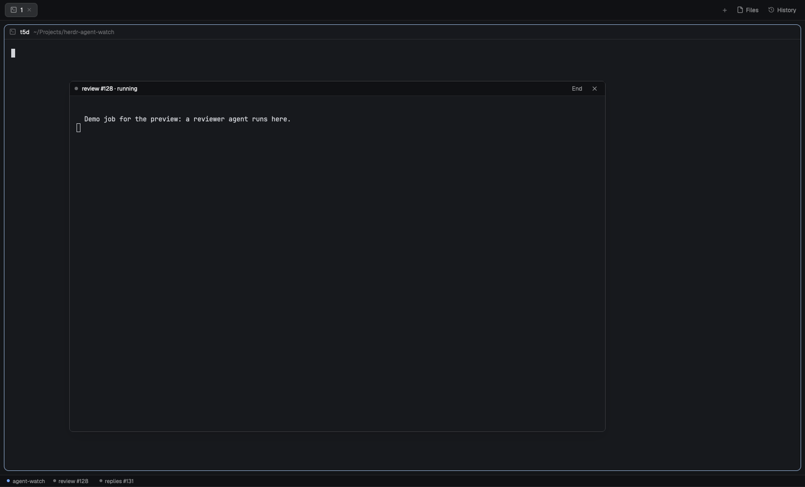

# agent-watch

A Herdr mod that starts coding agents when something happens. A background watcher runs your rules every few minutes; a rule checks something (a review request, a failed build, a new ticket) and starts an agent with a task, in its own worktree when it needs one. You see every agent it started in a strip at the bottom of the window.

It ships with rules for GitHub pull requests: Claude reviews the PRs that ask for your review and Codex cross-checks the review, and Claude triages new comments on your own PRs. Nothing is posted or pushed until you say so. Other sources are a rule away: see [Your own rule](#your-own-rule).



## What it does

A 24px strip at the bottom of the window shows the watcher and every agent it started. Click an agent to open it in a window; the window's title bar has an `End` button that stops the agent and its helpers.

The watcher is a shell loop (`engine.sh`) that runs the rules listed in your config every 5 minutes.

## Shipped rules: GitHub

| Rule | When | What happens |
|---|---|---|
| `github-review-requested` | your review is requested on a non-draft PR | checks the PR out in a free review slot, starts `pr-reviewer`, which starts `pr-crosscheck` |
| `github-review-approved` | you approved a PR under review | stops its agents, removes the slot worktree |
| `github-my-pr-comments` | others commented on your open PR | starts `pr-replies` in the branch's worktree, or pings it when it already runs |
| `github-my-pr-merged` | your PR merged | stops `pr-replies`, removes the clean branch worktree and the branch |
| `github-my-pr-conflicts` | your open PR conflicts with its base | one banner when the conflict appears, one when it is gone |

A worktree with uncommitted changes, local commits that are not in the PR, or a live terminal inside it is never removed: you get one warning instead.

## Requirements

- macOS (the scripts use BSD `stat` and `date`, and `osascript`)
- [Herdr](https://herdr.dev) with `hc` and `herdr-app` on `PATH`
- `jq`, `git`, `bash`

For the shipped GitHub rules:

- `gh`, logged in (`gh auth login`) with access to the watched repos
- [Claude Code](https://claude.com/claude-code) (`claude`) for the reviewer and the triage agent
- [Codex](https://github.com/openai/codex) (`codex`) for the cross-check

Your own rules may start any agent `hc` can run.

- Optional: `terminal-notifier` (`brew install terminal-notifier`) for banners that open the agent on click. Without it banners come from `osascript` and are not clickable.

## What it touches outside its folder

Tell the person before installing. The mod:

- runs programs: `hc`, `gh`, `git`, `jq`, your agent commands, and the optional `worktree.pre_remove` hook from your config;
- reaches the network through `gh` and `git fetch`;
- writes `~/.config/herdr-core/templates/pr-reviewer.md`, `pr-replies.md` and `pr-crosscheck.md` (never over a template it did not write);
- keeps its config and state in `~/.config/herdr-core/agent-watch/`;
- writes review files to `reviews_dir` and `replies_dir`;
- adds and removes git worktrees and deletes merged branches in the clones you list.

## Install

1. Copy `mods/agent-watch` to `~/.config/herdr-app/mods/agent-watch`.
2. Create the config:

   ```sh
   mkdir -p ~/.config/herdr-core/agent-watch
   cp ~/.config/herdr-app/mods/agent-watch/config.example.json ~/.config/herdr-core/agent-watch/config.json
   ```

   Edit `vars.repos` at least.
3. Add the block to your layout, above the status bar:

   ```json
   { "id": "agent-watch", "type": "block", "content": { "mod": "agent-watch" }, "size": { "px": 24 } }
   ```

4. Optional: merge `keys.json`. It binds `cmd-w` to `agent-watch.close`, which closes the agent window that has the keyboard and falls back to `tab.close`.

The mod starts the watcher as terminal `agent-watch` and restarts it within a minute when it ends. While something is missing (a program, the config, the `gh` login when a GitHub rule is enabled), the watcher says what in its log and waits. Click `agent-watch` in the strip to read the log.

Try it without side effects:

```sh
bash ~/.config/herdr-app/mods/agent-watch/engine.sh --dry-run --once
```

## Config

`~/.config/herdr-core/agent-watch/config.json`. A leading `~` expands to your home. After an edit, restart the watcher: `hc kill agent-watch`.

| Key | Meaning | Default |
|---|---|---|
| `interval` | seconds between ticks | `300` |
| `vars.repos[].name` | short name used in logs and state paths | required |
| `vars.repos[].repo` | `owner/name` on GitHub | required |
| `vars.repos[].base` | base branch | required |
| `vars.repos[].repo_dir` | the clone that holds the review slot worktrees | required |
| `vars.repos[].clone_dirs` | every clone whose branch worktrees are yours to clean up | required |
| `vars.repos[].worktrees_dir` | worktree folder inside a clone | required |
| `vars.repos[].terminal_prefix` | prefix for terminal names, to tell repos apart | `""` |
| `vars.repos[].title_prefix` | prefix for the titles in the strip | `""` |
| `vars.repos[].slot_pool` | name of the review slot pool | required |
| `vars.repos[].review_docs` | what the reviewers must read in this repo | the repo's agent instructions |
| `vars.repos[].replies_docs` | what the triage agent must read | `review_docs` |
| `vars.repos[].fix_notes` | how to make a worktree, which checks to run, commit format | the repo's own instructions |
| `vars.review_slots` | parallel reviews per pool | required |
| `vars.reviews_dir`, `vars.replies_dir` | where agents write their files | `~/.agent-watch/…` |
| `vars.github_login` | your login, named in the templates | from `gh api user` |
| `vars.output_language` | language of the reports' prose | `English` |
| `vars.comment_language` | language of comment and reply drafts | `English` |
| `vars.commands.*` | the words you type to the agents: `fix`, `commit`, `reply`, `recheck`, `submit` | `fix`, `commit`, `reply`, `check new`, `submit` |
| `vars.agents.reviewer`, `.replies`, `.crosscheck` | the command line of each agent | see `config.example.json` |
| `vars.notes.reviewer`, `.replies`, `.crosscheck` | extra instructions appended to a template | `""` |
| `notify.terminal_notifier` | path to a `terminal-notifier` binary | Homebrew paths |
| `worktree.pre_remove` | hook before a worktree is removed, see below | none |
| `rules[]` | `name`, `file`, `enabled`, `config` of each rule, run in this order | |

Report headings stay in English in every language, so the agents can refer to them.

Codex needs `--no-daemon` under `hc`, or its commands run outside the terminal.

### Worktree hook

When a worktree needs a teardown before removal (containers, a dev database):

```json
"worktree": {
  "pre_remove": {
    "if_file": "docker-compose.yml",
    "run": "docker compose down",
    "path_prepend": ["/opt/homebrew/bin"]
  }
}
```

`run` executes in the worktree when `if_file` exists there. When it fails, the worktree stays.

## Templates

`mods/agent-watch/templates/*.md` are the agent instructions with `{{parameters}}`. The watcher renders them into `~/.config/herdr-core/templates/` when it starts with a GitHub rule enabled, because `hc` reads templates only there and substitutes nothing.

To change the instructions beyond the parameters, copy a template to `~/.config/herdr-core/agent-watch/templates/<name>.md` and edit the copy. It replaces the shipped one and may use the same parameters: `reviewer_command`, `replies_command`, `crosscheck_command`, `reviews_dir`, `github_login`, `output_language`, `comment_language`, `cmd_fix`, `cmd_commit`, `cmd_reply`, `cmd_recheck`, `cmd_submit`, `repos_review`, `repos_replies`, `repos_fix`, `reviewer_notes`, `replies_notes`, `crosscheck_notes`, `notify`.

## Your own rule

A rule is a shell function `rule_<name with - as _>` in `rules/<file>`, listed in `rules[]` of the config. It runs once per tick and uses the primitives of `lib.sh`:

- `spawn <name> <cwd> <template> <task> [label...]` starts an agent and makes sure its task arrived
- `stop_terminals <label> <name...>` ends terminals and their children
- `slot_free`, `slot_take`, `slot_release`, `slot_list` limit parallel jobs
- `wt_busy_reason`, `wt_remove` handle worktrees
- `notify <title> <body> [terminal]`, `warn_once <key> <title> <body>`
- `act <what> <cmd...>` runs a command, or only logs it in a dry run
- `var`, `var_list`, `rule_cfg`, `rule_state` read config and give the rule its state folder

Every agent started with `spawn` carries the label `agent-watch=1` and shows in the strip; the label `aw.title=<text>` names it there.

An example, one agent per failed CI run of yours:

```sh
# rules/ci.sh
rule_ci_failed() {
  local seen id branch url
  seen="$(rule_state)/seen.txt"; touch "$seen"
  gh run list --repo "$(rule_cfg repo)" --user "$(gh api user --jq .login)" --status failure --limit 5 \
      --json databaseId,headBranch,url --jq '.[] | [.databaseId, .headBranch, .url] | @tsv' |
    while IFS=$'\t' read -r id branch url; do
      grep -qx "$id" "$seen" && continue
      spawn "ci-$id" "$(rule_cfg repo_dir)" "$(rule_cfg template)" \
        "CI run $url failed on branch $branch. Find the cause and propose a fix. Do not push." \
        "aw.title=ci $branch" && echo "$id" >> "$seen"
    done
}
```

```json
{ "name": "ci-failed", "file": "ci.sh", "enabled": true,
  "config": { "repo": "your-org/your-repo", "repo_dir": "~/code/your-repo", "template": "ci-fixer" } }
```

`template` is an `hc` template of yours (`~/.config/herdr-core/templates/ci-fixer.md`): the agent's command line and its standing instructions. Try a new rule with `bash engine.sh --dry-run --once ci-failed`.

### Ideas for rules

None of these ship with the mod; each is a rule like the one above.

- A ticket is assigned to you in Jira or Linear: an agent drafts a plan in a new worktree.
- A new error appears in Sentry or Rollbar: an agent looks for the cause and rates it.
- A dependency bot opens a PR: an agent reads the changelog and checks the callers.
- You are mentioned in a chat thread: an agent drafts the answer.
- On a schedule: triage of flaky tests every night, a sweep of stale branches every week.
- GitLab merge requests in place of GitHub pull requests.
- Notify only, no agent: a red build, a stuck deploy, a quota that ran out.

## Limits

- macOS only.
- Rules are polled, every `interval` seconds. There are no webhooks.
- The reviewer always asks Codex for a cross-check. When Codex does not answer, the reviewer goes on without it and says so.
- When the mod folder is renamed, change `MOD` in `titlebar.js` to the new name.

## License

MIT, see [LICENSE](LICENSE).
