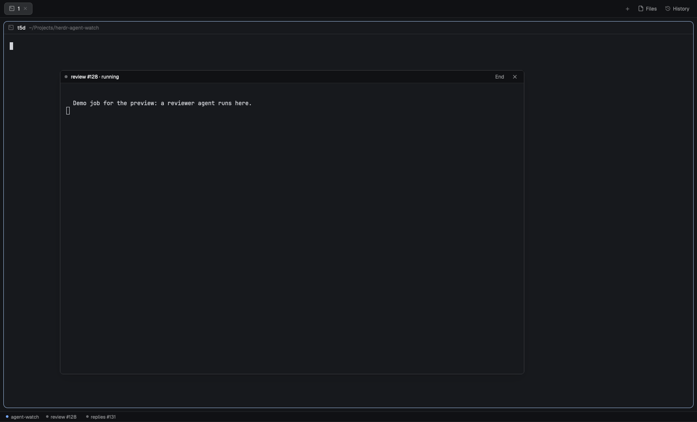

# agent-watch

A thin strip at the bottom of the window lists the coding agents that a background watcher started when something happened. The watcher runs rules every few minutes; the shipped rules start a review for each pull request that asks for the person's review and a triage of new comments on the person's own pull requests, and a new rule is a few lines of shell. A click opens an agent in a floating window with a title bar that can end it.

**What you see**

- A strip 24px high across the bottom, chrome background, 1px top border, 11.5px muted text, 14px side padding, 10px between items.
- Left: a 6px round dot and the word `agent-watch`. The dot has the theme's `done` color while the watcher terminal is live and the `blocked` color with the text `agent-watch: starting…` while it is not.
- Then one item per agent: a 6px status dot and its title, for example `review #15` or `replies #7`. With no agents, the dim text `no open jobs`.
- An agent window: 1100×720, a 30px title bar over the agent's terminal. The title bar has a 7px status dot, `<title> · <status>` in 12px text, an `End` button and a `✕` button.

**How it behaves**

- Status dots use the theme colors `working`, `blocked`, `done`, `idle`; any other status uses `unknown`. A live terminal that is not an agent shows `running` in the title bar, one that is gone shows `finished`.
- A click on an agent opens its window. A click on `agent-watch` opens the watcher's log in the same kind of window, without the `End` button.
- Items highlight with the theme's `hover` background under the pointer.
- `End` asks first: it turns into `End for sure?` in the `blocked` color for 3 seconds. A second click kills the agent's live child terminals, then the agent, then closes the window. While that runs it reads `Ending…`.
- `✕` closes the window and leaves the agent running.
- The command `agent-watch.close` (bound to `cmd-w` in `keys.json`) closes the agent window whose terminal has the keyboard; otherwise it runs `tab.close`.
- Every minute the strip checks that a live terminal named `agent-watch` exists and starts the watcher when it does not.
- A notification from the watcher shows as a Herdr toast and a macOS banner; a click on either opens the agent's window.

**Built from**

- One mod folder, `mods/agent-watch`, used in two roles. Without props it is the strip (`mod.json`: `{ "place": "bottom", "size": 24 }`). With `props: { role: "titlebar", name, title }` it is the title bar of an agent window. `main.js` picks the role in `init`; `titlebar.js` holds the title bar and the constants `MOD` and `WATCHER`.
- The agent window: `openOverlay({ kind: "window", key: "agent-watch:<name>", width: 1100, height: 720, layout: column[ block 30px { mod: "agent-watch", props: { role: "titlebar", name, title } }, block { terminal: <address> } ] })`. Its overlay id is kept in the shared value `agent-watch-window:<name>` so the title bar can close it.
- `herdr` functions: `terminals`, `theme`, `props`, `shared`, `setShared`, `openOverlay`, `closeOverlay`, `notify`, `nextCommand`, `focused`, `run`, `hc`, `appHome`, `checking`.
- Commands it answers through `nextCommand()`: `open:<terminal name>`, `say:<JSON {terminal, title, body, level}>`, `close`.
- Agents are the live terminals with the label `agent-watch=1`; the label `aw.title` is the title shown.
- Programs: the strip runs `hc run --bg --no-parent --name agent-watch bash <appHome>/mods/agent-watch/engine.sh`; the title bar runs `hc kill`.
- The watcher is shell, in the same folder: `engine.sh` (the loop, `--once`, `--dry-run`), `lib.sh` (primitives for rules), `rules/github-pr.sh` (five GitHub rules), `notify.sh` (toast through `herdr-app do agent-watch.say:…`, banner through `terminal-notifier` or `osascript`), `render-templates.sh` (fills `templates/*.md` from the config and writes them to `~/.config/herdr-core/templates/`). It runs `gh`, `git`, `jq`, `hc`.
- Config and state are in `~/.config/herdr-core/agent-watch/`, outside the mod folder.

**Watch out**

- Herdr reloads a mod when a file in its folder is saved. State or a config inside the folder would reload the strip on every tick, so both live outside.
- `herdr-app check` runs `init` for real. Starting the watcher is behind `checking()`, or every check would start one.
- `hc` reads templates only from `~/.config/herdr-core/templates/` and substitutes nothing; the render step is required before the first agent starts.
- A banner must come from a real `terminal-notifier` binary. A version-manager shim fails outside a project folder, and an `osascript` banner opens Script Editor on click.
- A mod sees `terminal.labels`, but `herdr-app check` gets an empty `terminals()`: verify the strip against a live labelled terminal (`hc run --bg --label agent-watch=1 --label aw.title=test sleep 600`).
- The watcher that ends at once would be restarted every minute and leave a pile of finished terminals. On a setup problem `engine.sh` stays alive, logs the problem and retries every 30 seconds.
- The scripts use BSD `stat -f` and `date -r`: macOS only.
- Codex under `hc` needs `--no-daemon`.
- An overlay window of a killed agent stays open until it is closed.

**Done when**

- `herdr-app check mods/agent-watch` passes and starts no terminal.
- With the block in the layout, a live terminal `agent-watch` appears within a minute and the strip's dot turns to the `done` color.
- `hc run --bg --label agent-watch=1 --label aw.title=test sleep 600` adds `test` to the strip; a click opens its window; `End` twice ends it and closes the window.
- `bash engine.sh --dry-run --once` logs what each rule would do and changes nothing.
- `bash notify.sh <terminal> Title Body` shows a toast and a banner, and a click opens that terminal's window.
- `~/.config/herdr-core/templates/pr-reviewer.md` exists after the watcher starts and contains no `{{`.
